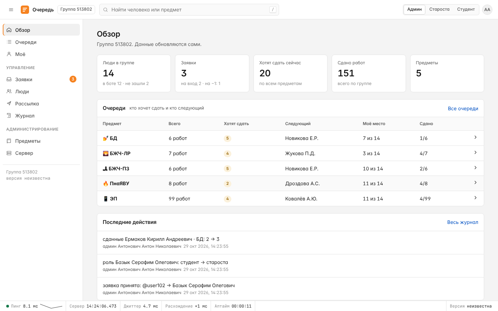
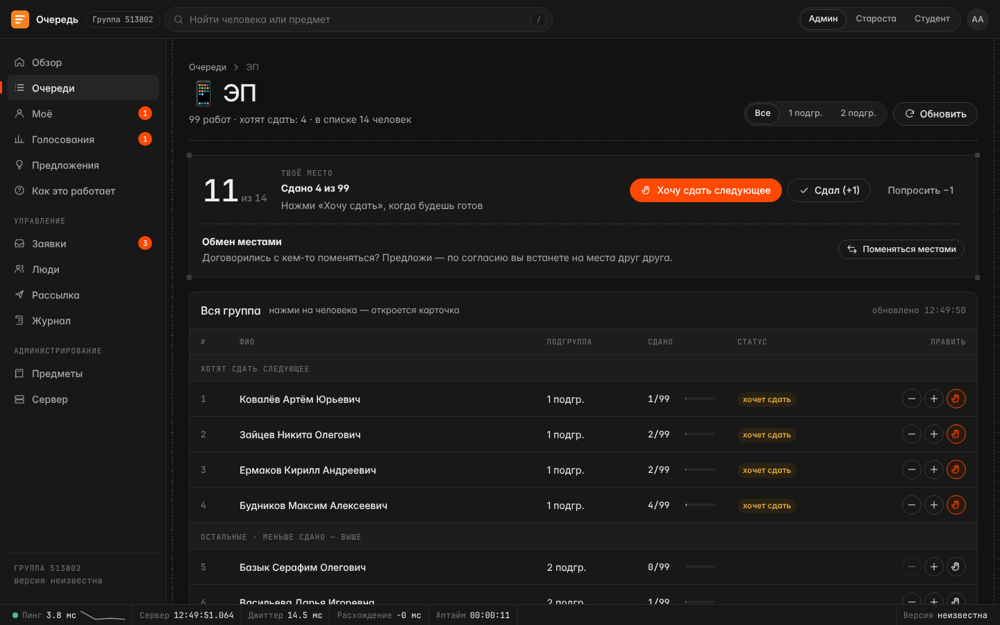
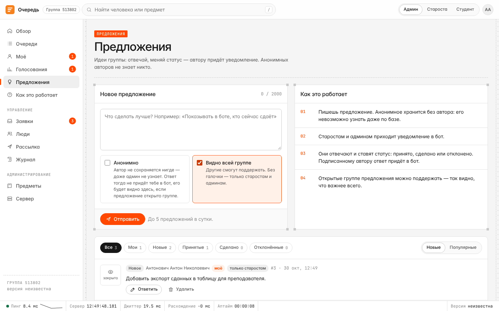
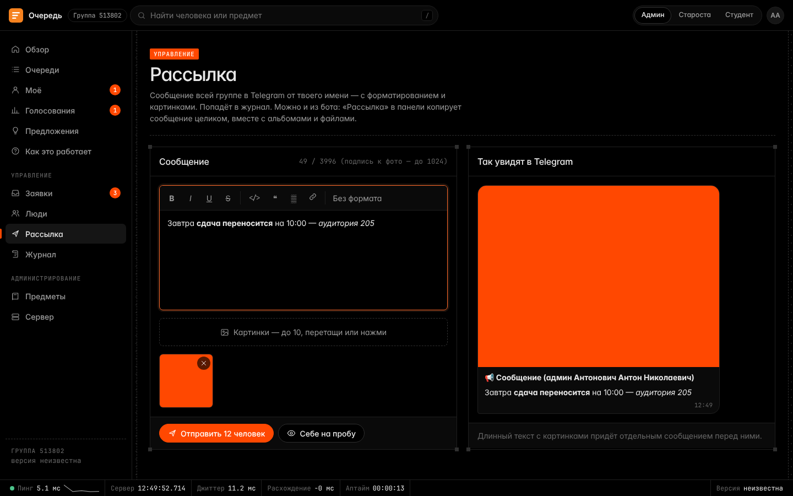
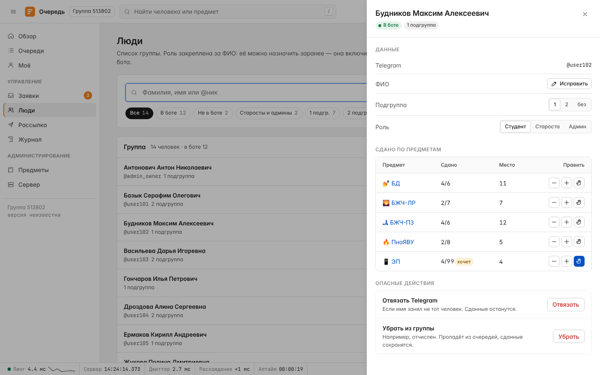
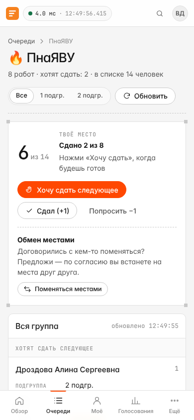
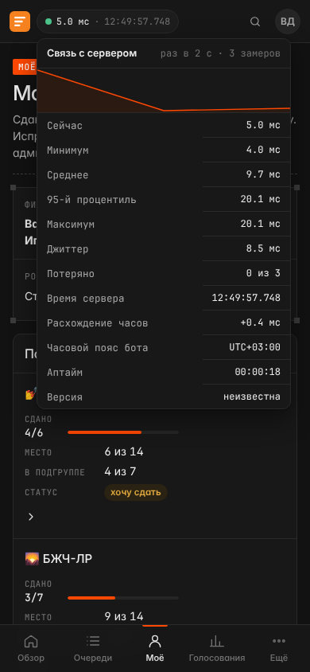

# Telegram-бот живой очереди на сдачу лаб

Бот для одной учебной группы. По каждому предмету есть **живая очередь** — в ней всегда вся
группа. Её открывают прямо на паре и смотрят, кто следующий. Никаких дат и расписаний.

Для разработчиков и нейросетей: [`AGENTS.md`](AGENTS.md) — быстрый контекст и правила,
[`docs/ARCHITECTURE.md`](docs/ARCHITECTURE.md) — точное устройство движка и базы данных.

## Как работает очередь
- **Список группы** хранится в базе бота (в репозиторий не попадает). Админ загружает его в
  `Панель Админа → Люди → Добавить людей` — вставляет текст списком, номера и отчисленные пропускаются.
- **Предметы** показываются с эмодзи (🔥 ПнаЯВУ, 🏞 БЖЧ-ПЗ, 🌄 БЖЧ-ЛР, 📱 ЭП, 💅 БД); название, эмодзи и число
  работ меняются в `Панель Админа → Предметы`.
- **«👤 Моё»** — ФИО, подгруппа, роль и по каждому предмету: сколько сдано и своё место в общей очереди и
  в своей подгруппе.
- **В очереди вся группа**, даже те, кто ещё не зашёл в бота (за них отмечает староста).
- **Регистрация**: при первом `/start` человек выбирает себя из списка, староста подтверждает.
  Одно имя — один аккаунт Telegram.
- **Порядок** (`ranking.py`):
  1. 🙋 **сверху** — кто нажал «Хочу сдать следующее». Среди них раньше тот, у кого меньше сдано,
     при равенстве — 🎲 жребий;
  2. **ниже** — все остальные: у кого меньше сдано, тот выше; при равенстве — по алфавиту;
  3. **в самом низу** — кто ещё не зашёл в бота: приоритета у них нет (если староста сам не поставил им 🙋).

  В очереди имена короткие — «Фамилия И.О.», при выборе себя — полное ФИО.
- **Жребий** (`random.SystemRandom` — случайность операционной системы) — одно число на человека,
  предмет, номер работы и день. Даёт каждому из равных одинаковый шанс на любое место; никакие нажатия
  его не меняют. В полночь у всех новый — на новой паре равные тянут заново.
- **Кнопка под полем ввода** — «🏠 На главную» всегда под рукой; всё остальное — кнопки под сообщениями бота.
  Если кнопки нет — напиши `/start`.
- **Обмен местами** — двое по обоюдному согласию (кнопка «🔁 Поменяться» в очереди) меняются местами по предмету, сколько бы у кого
  ни было сдано. Меняются только они двое — места остальных не двигаются. Обмен действует, пока кто-то из пары не сдаст
  (потом оба на своих местах), и отменить его можно в любой момент. Один обмен на каждую работу: следующий — после того, как
  сдано на одну больше (откат этого не возвращает). Если один из пары с 🙋, а другой без, обмен ждёт, пока оба не будут в одном
  блоке. Админ видит действующие обмены (`Панель Админа → 🔁 Обмены`) и может их разорвать.
- **Функции по ролям** — админ в `Панель Админа → ⚙️ Функции` (или веб `Сервер → Функции по ролям`) включает и выключает обмены,
  голосования и предложения отдельно для студентов, старост и админов. Очередь отключить нельзя; создатель видит всё всегда.
- **Копии на других серверах** (заготовка) — бот шифрует копию базы и сам отправляет её на ваш приёмник (`deploy/receiver/queue-bot-receiver.py`), хранится последние N; настройка `BACKUP_KEY` и `BACKUP_TARGETS` в `/etc/queue-bot/env`, статус и кнопка «Отправить сейчас» — в вебе на странице «Сервер».
- **Live** (только админ, веб-панель) — нагрузка и события сервера в реальном времени: запросы в секунду, время ответа, процессор и память, схема «Telegram → бот → база ← веб», лента событий (веб, бот, логи, действия) и график за последний час. Тексты сообщений людей туда не попадают.
- **Кто онлайн** — зелёная точка у тех, кто сейчас в веб-панели, и «был в сети» (веб и бот). По умолчанию видно только старостам и админам; включается в «Функциях».
- **Цветные ники** в веб-панели: староста — зелёный, админ — фиолетовый, создатель — с градиентной рамкой.
- **Подгруппы** — фильтр просмотра: в очереди кнопки «Все · 1 подгр. · 2 подгр.». Очередь одна и та же,
  фильтр просто скрывает другую подгруппу (номера — внутри подгруппы). Подгруппы админ загружает списком
  в `Панель Админа → Люди → 🔢 Подгруппы`, одному человеку — в его карточке.
- **«🔄 Обновить»** — перечитывает очередь (видно время обновления). Между нажатиями — 3 секунды,
  чтобы не упереться в лимиты Telegram.
- **«✅ Сдал»** — счётчик сданных +1, человек остаётся в списке, отметка 🙋 снимается.
  Ошибся — «↩️ Отменить» в течение минуты. Позже — «🙏 Попросить −1» с причиной: заявку одобряет
  староста или админ (свою — нельзя). «−1» под контролем, потому что меньше сдано — выше в очереди.

## Роли и панели (`/admin` — Панель Админа, `/moderator` — панель старосты)
- **Студент** — смотрит очереди, поднимает руку, отмечает сданные.
- **Староста** — принимает заявки, правит ФИО и сданные, ставит и снимает 🙋 (в том числе
  за тех, кого нет в боте), делает рассылку, смотрит журнал.
- **Админ** — всё то же, плюс список группы (добавить, убрать отчисленного, вернуть), роли
  (назначить студентом, старостой или админом), отвязка Telegram, предметы, серверные логи и
  **копия базы** (`💾 Копия базы` → файл `bd-513802-28-10-2026-1250.zip` с полной копией) и
  **голосования** (`🗳 Голосования`): вопрос и от 2 до 8 вариантов уходят всей группе кнопками. Голос анонимный (видно
  цифры, но не кто за что) и пока голосование открыто его можно поменять; админ видит, кто ещё не голосовал, может
  напомнить им и закрыть голосование — тогда всем приходят итоги. То же есть в веб-панели: раздел «Голосования» (админ создаёт и закрывает, остальные голосуют).
- **Создатель** 👑 — Telegram ID в `CREATOR_IDS` на сервере (старая переменная `ADMIN_IDS` тоже работает). Может всё, как админ, и его нельзя
  снять из бота — так доступ к боту не потеряется, даже если кто-то снимет всех остальных админов.

Роль меняется в `Панель Админа → Люди → человек`: кнопки «✅ Студент», «✴️ Староста», «♒️ Админ».
В списке людей значки: ✅ студент · ✴️ староста · ♒️ админ · ❌ не зарегистрирован.
Роль можно назначить **заранее**, даже если человек ещё не зашёл в бота: она закреплена за ФИО,
и права появятся, как только его заявку примут (проверяющего бот предупредит, что у имени есть роль).

В меню команд Telegram каждый видит своё: студенты — обычные команды, старосты — ещё `/moderator`,
админы — `/admin`; кому открыта веб-панель — ещё `/web`.

Каждое действие старост и админов пишется в журнал, а тому, кого оно касается, приходит уведомление.
**Журнал** (в блоках кода, по страницам): «Действия» — кто что сделал (видят старосты и админы);
«Сервер», «Ошибки», «Всё» — серверные логи бота, только админ; у ошибок есть кнопка «Последняя ошибка целиком»
с traceback. Токен бота из логов вырезается. Логи хранятся в базе (последние 5000 строк).
При первом запуске предметы берутся из `config.py` (`SUBJECTS`), дальше меняются в Панели Админа.

## Веб-панель
Весь бот в браузере — для студентов, старост и админов: обзор с поиском, очереди («Хочу сдать», «Сдал», «Отменить»,
«Попросить −1», обмен местами), «Моё», голосования, **предложения** (открыто или анонимно), правила; старостам и админам —
заявки, люди с поиском и карточкой, рассылка с форматированием и картинками, журнал; админам — предметы и сервер
(обновление и копия базы). Удобно и на ПК, и на телефоне: на узком экране — нижние вкладки, таблицы становятся
карточками, горизонтальной прокрутки нет. Внизу всегда видна строка связи: пинг до сервера
(с джиттером и графиком, по клику — минимум, среднее, 95-й процентиль, потери), время сервера до миллисекунд,
расхождение часов и аптайм. Темы: как в системе, светлая, тёмная и AMOLED.

| Обзор · светлая | Очередь · тёмная |
|---|---|
|  |  |
| **Предложения** | **Рассылка с форматированием · AMOLED** |
|  |  |
| **Карточка человека** | **Телефон: очередь студента · пинг и время сервера** |
|  |   |

**Входить могут все из списка группы** (`WEB_ROLES=admin,starosta,user`). Каждый видит своё; админ может посмотреть
панель глазами старосты или студента переключателем сверху (права только понижаются, проверяет сервер). Закрыть веб
студентам — `WEB_ROLES=admin,starosta`.

**Предложения.** Любой может предложить идею — подписанно или анонимно, всей группе (тогда её можно поддержать) или
только старостам и админам. Анонимное хранится без автора: узнать, кто написал, нельзя даже по базе. Старосты и админы
получают уведомление в боте, отвечают и ставят статус; подписанному автору ответ приходит в бот.

**Рассылка с форматированием.** В боте (`Панель → 📢 Рассылка`) пришли сообщение как обычно — с жирным, курсивом,
подчёркиванием, зачёркиванием, моноширинным, спойлером, ссылками, цитатами, с картинкой, видео, файлом или альбомом: бот
разошлёт его копию, ничего не потеряв. В веб-панели — редактор с теми же кнопками и до 10 картинок, плюс «Себе на пробу».

**Как мини-приложение Telegram.** Если `WEB_URL` начинается с `https://`, панель открывается прямо в Telegram, как
приложение: в ответе на `/web` появляется кнопка «📱 Открыть в Telegram», а у тех, кому панель разрешена, рядом с полем ввода —
кнопка меню «Панель». Вход автоматический: Telegram сам подписывает, кто ты, и бот проверяет подпись токеном бота — ссылка
не нужна. Тема берётся как в Telegram. Работает в приложениях Telegram на телефоне и компьютере; в Telegram Web (в браузере)
не откроется — там используй обычную ссылку из `/web`.

**Вход** — без пароля: в боте `/web` (или `Панель Админа → 🌐 Веб-панель`) → одноразовая ссылка на 10 минут →
«Войти в панель». Сессия живёт в браузере 30 дней; выйти везде — `Сервер → Выйти на всех устройствах`. Права
проверяются на каждом запросе: сняли роль в боте — доступ пропадает сразу. Действия из веба пишутся в тот же
журнал (с пометкой «· веб»), а людям приходят те же уведомления в Telegram.

Панель работает в том же процессе, что и бот, и по умолчанию слушает только сам сервер — `127.0.0.1:8080`.
Наружу её выпускают **только через HTTPS**, например:
- **Cloudflare Tunnel** (белый IP и открытые порты не нужны): `cloudflared tunnel --url http://127.0.0.1:8080`
  или постоянный туннель на свой домен; в `/etc/queue-bot/env` впиши `WEB_URL=https://<адрес туннеля>`;
- **только себе** — через SSH: `ssh -L 8080:127.0.0.1:8080 <сервер>` и открыть ссылку из бота у себя
  (`WEB_URL` тогда не нужен).

Настройки меняются командой `sudo queue-bot config` (откроется редактор), бот перезапустится сам.

## Настройки
Задаются в `.env` (см. `.env.example`).

| Переменная | Описание | По умолчанию |
|---|---|---|
| `BOT_TOKEN` | токен от @BotFather, **обязательно** | — |
| `CREATOR_IDS` (или старая `ADMIN_IDS`) | Telegram ID создателей через запятую. Если пусто — заявки принимаются автоматически | — |
| `DB_PATH` | путь к файлу SQLite | `data/queue.db` |
| `TIMEZONE` | часовой пояс для времени в журнале | `Europe/Minsk` |
| `GROUP_NO` | номер группы — только для имени файла копии базы | `513802` |
| `WEB_PORT` | порт веб-панели; `0` — выключить | `8080` |
| `WEB_HOST` | на каком адресе слушать веб-панель | `127.0.0.1` |
| `WEB_URL` | публичный адрес панели для ссылок из бота (`https://…`) | `http://WEB_HOST:WEB_PORT` |
| `WEB_ROLES` | кому можно в веб-панель: `admin`, `starosta`, `user` через запятую | все три |

Свой Telegram ID можно узнать, например, у @userinfobot.

## Локальный запуск
```bash
python3 -m venv .venv && source .venv/bin/activate
pip install -r requirements.txt
cp .env.example .env   # впиши BOT_TOKEN и CREATOR_IDS
python main.py
```

## Тесты
```bash
pip install pytest
python -m pytest
```

## Запуск на сервере (Debian 12/13)
Белый IP, домен и открытые порты не нужны: бот сам ходит в Telegram (polling).
Запускать нужно **одну** копию с одним токеном — две будут мешать друг другу.

**Установка** (один раз):
```bash
sudo apt update && sudo apt install -y git
git clone https://github.com/millirim/queue-bot-fork.git ~/queue-bot
sudo bash ~/queue-bot/deploy/install.sh
```
Скрипт спросит токен бота (проверит его в Telegram) и твой Telegram ID, поставит всё и запустит
бота как службу. После установки `~/queue-bot` можно удалить. Повторный запуск установки безопасен.

**Где что лежит** — код отдельно от данных, поэтому обновления ничего не трогают:
| Что | Где |
|---|---|
| код (можно стереть и скачать заново) | `/opt/queue-bot` |
| настройки: токен, админы (вводятся один раз) | `/etc/queue-bot/env` |
| база и бэкапы | `/var/lib/queue-bot` |

**Команда `queue-bot`:**
| Что | Команда |
|---|---|
| обновить из GitHub | `sudo queue-bot update` |
| работает ли и какая версия | `queue-bot status` |
| логи в реальном времени (выход — Ctrl+C) | `queue-bot logs` |
| перезапуск / стоп / старт | `sudo queue-bot restart` · `stop` · `start` (пока бот перезапускается, дежурный отвечает людям «подожди пару минут») |
| бэкап сейчас | `sudo queue-bot backup` |
| обновить кнопкой | в боте: `Панель Админа → 🔄 Обновить бота` |
| изменить токен или админов | `sudo queue-bot config` |

`update` показывает, что нового, делает бэкап базы, обновляет код и зависимости и перезапускает
бота. Если новая версия не запустилась — сам возвращает прошлую. Бэкап базы ещё и каждый день
в 4:00, хранятся 14 дней.

**Обновление кнопкой.** Админ может обновить бота прямо из Telegram: `Панель Админа → 🔄 Обновить бота → ✅ Обновить сейчас`.
Бот сам прав root не имеет, поэтому он только оставляет запрос, а `systemd` запускает ту же `queue-bot update`
(бэкап базы, откат, если новая версия не запустилась). Итог — что нового или почему не вышло — приходит админу в чат.
**Один раз**, когда эта функция только появилась, выполни на сервере `sudo queue-bot update` **два раза подряд**:
в первый раз он скачает новую версию (старая команда `queue-bot` про новые службы не знает), во второй включит
нужные службы. Дальше кнопка работает сама.

Бот работает от отдельного пользователя `queuebot` без прав root и может писать только в
`/var/lib/queue-bot`. Токен в `/etc/queue-bot/env` читает только root.

**Восстановить базу из бэкапа:**
```bash
sudo queue-bot stop
sudo cp /var/lib/queue-bot/backups/queue-<дата>.db /var/lib/queue-bot/queue.db
sudo rm -f /var/lib/queue-bot/queue.db-wal /var/lib/queue-bot/queue.db-shm
sudo chown queuebot:queuebot /var/lib/queue-bot/queue.db
sudo queue-bot start
```

## Лицензия
[GNU GPL v3](LICENSE): код можно свободно использовать, менять и распространять,
но изменённые версии тоже должны выходить под GPLv3 с открытым кодом.
